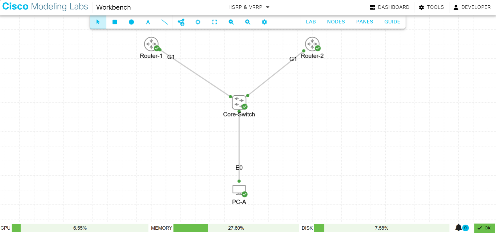

# Enterprise High Availability Infrastructure: A Comparative Lab Study of HSRP and VRRP

## Executive Summary & Production Use Case
In modern enterprise network architectures, high availability at the distribution and access layers is critical to business continuity. If an office LAN relies on a single hardware router interface as its default gateway, that device represents a catastrophic single point of failure. 

To eliminate this vulnerability, network engineers deploy First Hop Redundancy Protocols (FHRPs). This lab provides a production-mode implementation, validation, and architectural comparison between two primary redundancy frameworks:
1. **Hot Standby Router Protocol (HSRP):** A Cisco-proprietary high-availability framework.
2. **Virtual Router Redundancy Protocol (VRRP):** An industry-open standard (IETF) protocol enabling multi-vendor interoperability.

By engineering a shared Virtual IP (VIP) and a corresponding Virtual MAC address across multiple physical platforms, we present a seamless, redundant gateway abstraction to local host end stations. If the primary forwarding engine suffers an abrupt hardware failure, the secondary node assumes forwarding responsibilities in seconds without client reconfiguration or manual intervention.

---

## 1. Network Topology Map & Physical Interconnections

The layout was simulated inside Cisco Modeling Labs (CML) utilizing Cisco CSR1000v virtual routers, a standard unmanaged Layer 2 Core-Switch, and a Linux Desktop environment. 

### Logical Layer 3 Addressing Scheme
*   **Virtual Gateway IP (VIP):** `192.168.1.1/24`
*   **Router-1 (Primary) Physical Interface Gi1:** `192.168.1.2/24`
*   **Router-2 (Secondary) Physical Interface Gi1:** `192.168.1.3/24`
*   **PC-A (End Host) Interface eth0:** `192.168.1.50/24` (Pointing to `192.168.1.1`)

### Verification Capture 1: CML Topology Workbench Map
Below is the validated physical topology wiring layout map demonstrating clear logical separation and shared broadcast layer boundaries through the central core switch.



---

## 2. Phase A: Cisco HSRP Configuration & Verification

HSRP was deployed to establish deterministic primary path optimization. Router-1 was configured with an elevated tracking priority value of `110` alongside active preemption parameters to ensure it assumes the Active forwarding role during initialization or post-failure recovery states.

### Core Command Implementation Stack

#### Router-1 (Active)
```text
Router-1(config)# interface GigabitEthernet1
Router-1(config-if)# ip address 192.168.1.2 255.255.255.0
Router-1(config-if)# standby 1 ip 192.168.1.1
Router-1(config-if)# standby 1 priority 110
Router-1(config-if)# standby 1 preempt
Router-1(config-if)# no shutdown
```

#### Router-2 (Standby)
```text
Router-2(config)# interface GigabitEthernet1
Router-2(config-if)# ip address 192.168.1.3 255.255.255.0
Router-2(config-if)# standby 1 ip 192.168.1.1
Router-2(config-if)# no shutdown
```

### Verification Capture 2: Router-1 HSRP Status Summarization
Execution of the verification sequence confirms Router-1 has successfully elected itself to the `Active` operational state, actively binding to the `192.168.1.1` VIP while tracking its standby peer at `192.168.1.3`.


### Verification Capture 3: Router-2 HSRP Status Summarization
Execution of the verification sequence on the secondary cluster node confirms Router-2 recognizes Router-1 (`192.168.1.2`) as the active root and has safely entered the redundant `Standby` tracking mode.


---

## 3. Phase B: The Core Operational Migration to VRRP

To accommodate modern heterogeneous multi-vendor production topologies (such as a Cisco access switch block uplinking into a non-Cisco core routing engine), the environment was migrated to the open-standard VRRP framework.

### Architectural Migration Sequence Logs
During the manual removal of the legacy HSRP sub-structures via the `no standby 1` interface configuration parameters, duplicate address warnings (`%IP-4-DUPADDR`) briefly triggered. This behavior occurred due to the near-simultaneous convergence attempts of both active engines over the same Layer 2 broadcast segment prior to complete protocol teardown. 

Once the interface tables cleared, the state transition engine settled seamlessly, registering structural interface adjustments from initialization states straight into active Master/Backup state pairs.

### Verification Capture 4: Router-1 VRRP Transition Terminal Logs
This console log shows the deletion of the legacy HSRP protocol, the subsequent duplicate address detection checks over the media access control layer, and the successful initialization of the open-standard VRRP engine.


### Verification Capture 5: Router-2 VRRP Transition Terminal Logs
This console capture displays the corresponding cleanup configurations applied to the secondary node, documenting the immediate transition into its calculated backup monitoring state.


---

## 4. Phase C: Final VRRP State Machine Verification

With the migration complete, the summary data matrix was pulled from both devices to verify structural path control and configuration stability.

### Verification Capture 6: Router-1 VRRP Master Matrix Status
The explicit `show vrrp brief` matrix output validates that Router-1 has assumed the standard **Master** role, actively protecting group ID `1` at an operational priority value of `110`.


### Verification Capture 7: Router-2 VRRP Backup Matrix Status
The corresponding verification capture on Router-2 confirms it has settled into the standard **Backup** role at its default priority of `100`. It explicitly tracks the active path through the Master Address (`Master addr`) pointing back to Router-1's physical IP interface (`192.168.1.2`).


---

## 5. Architectural Technical Breakdown: VRRP vs. HSRP

When analyzing network infrastructure resiliency for modern deployments, it is critical to understand the narrative and functional variances between these two frameworks:

**Hot Standby Router Protocol (HSRP)** is a Cisco-proprietary protocol, meaning it is specifically designed to function within an environment entirely built with Cisco hardware. In HSRP, the two routers elect an **Active** router to handle user traffic and a **Standby** router to patiently wait in the background. Because it is optimized for Cisco networks, its default timers are conservative—sending keepalive hellos every 3 seconds and waiting 10 seconds before failing over. 

On the other hand, **Virtual Router Redundancy Protocol (VRRP)** is an open industry standard governed by the IETF, which means it allows multi-vendor interoperability. Engineers use VRRP when connecting a Cisco switch infrastructure to a Juniper firewall cluster or an Arista core router. VRRP changes the terminology, electing a **Master** router to actively forward packets and a **Backup** router to monitor the state. Out of the box, VRRP is designed to be much more aggressive than HSRP; it sends its advertisements every single second and triggers a failover in roughly 3.6 seconds, giving your enterprise network faster recovery times without requiring manual timer tuning.
